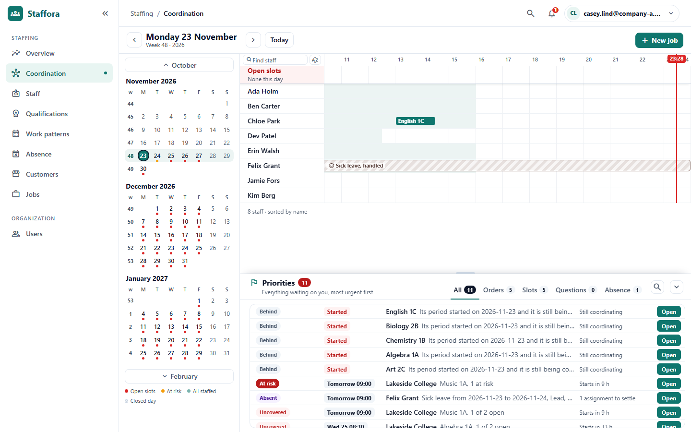
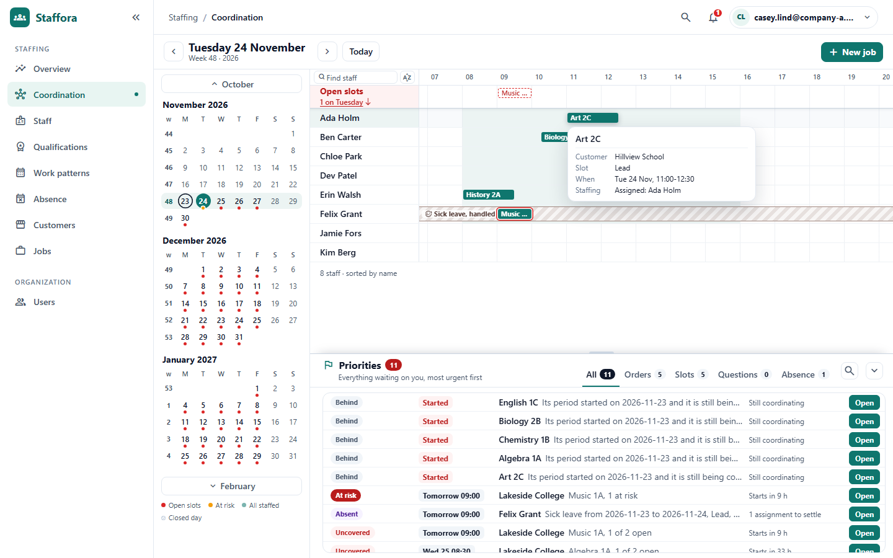
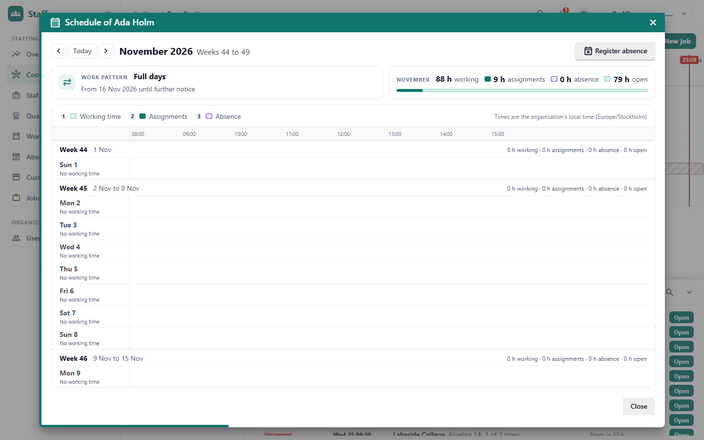

# Staffora

Staffora is a multi-tenant SaaS for companies that send their own staff out on jobs for their customers: a cleaning crew to an office, carers to a home, teachers to a school.
Coordinators plan the jobs, see who is qualified and free, and request or assign staff. Staff accept or decline. Customers order jobs through a portal of their own.
Each company is a tenant that never sees another, and a platform owner runs them all. Built with Blazor Server, .NET 10, EF Core and SQL Server.

What the product is, and what it is not, is in [PRODUCT.md](PRODUCT.md).



## What it shows

- **Tenant isolation in the data layer.** Every tenant row is filtered on read and checked on write inside the EF Core context. With no tenant, the filter returns nothing. Crossing the boundary takes an explicit, logged lease with a reason. Source scans make sure only allow-listed code can do it.
- **A declarative workflow engine.** Every entity with a lifecycle (job, slot, assignment, absence, user, tenant and the rest) declares its states, transitions, permissions, conditions and per-state field access in one attribute class. One service runs every step in one transaction, and the dialogs draw their buttons and fields from the same declaration.
- **A cross-tenant customer portal over an outbox.** A customer's order is written straight into the staffing company's tenant, stamped with that tenant's system account. Everything after that crosses as messages through an integration outbox: in order per correlation, idempotent, with dead letters shown on the platform console.
- **Audited impersonation.** The platform owner works inside a tenant only by acting as one of its users. The session lives on the auth cookie, is checked again on every circuit and is recorded from start to end.
- **Retention.** An hourly pass removes old error-log rows, read notices and processed outbox messages, and purges and archives a tenant whose grace period has ended.
- **Telemetry.** OpenTelemetry traces and metrics over OTLP, switched on by one environment variable. Tags are ids and keys, never a person's name or address.
- **An accessibility-tested UI.** Every text pair is held at 4.5:1 by a test over the design tokens. The browser journeys run axe on every page and dialog, and they fail on any serious or critical violation.

| Hover card on the timeline | A staff member's schedule |
|---|---|
|  |  |

## Quick start

### Local development

You need the .NET 10 SDK and SQL Server Express LocalDB (it comes with Visual Studio).

```powershell
dotnet run --project Staffora.Blazor
```

The first start creates the `stafforadb` database on `(localdb)\mssqllocaldb`, applies the migrations and builds the demo through the application's own services. That takes about 70 seconds. Later starts reuse it. Open the address the console prints (http://localhost:5055 with the `http` profile).

## Demo sign-ins

The demo has five companies in different trades (schools, cleaning, construction, home care and security), each with system owners, coordinators, staff and a customer portal.

| Who | Email | Password |
|---|---|---|
| Platform owner | `admin@staffora.system` | `Admin123!` |

The full list of people and their passwords is in [docs/features/demo-data.md](docs/features/demo-data.md#demo-data). The demo exists only in the Development environment. Every name in it is made up.

## Start here

Eight files that show how the system holds together:

1. [`Staffora.Data/ApplicationDbContext.TenantIsolation.cs`](Staffora.Data/ApplicationDbContext.TenantIsolation.cs): the query filter and the write checks behind every tenant row.
2. [`Staffora.Data/BulkUpdateGuard.cs`](Staffora.Data/BulkUpdateGuard.cs): how `ExecuteUpdate` and `ExecuteDelete` are kept inside the same boundary.
3. [`Staffora.Core/Workflow/Workflow.cs`](Staffora.Core/Workflow/Workflow.cs): the workflow engine, its states, transitions and conditions.
4. [`Staffora.Core/Workflow/WorkflowAttributes/JobWorkflowAttribute.cs`](Staffora.Core/Workflow/WorkflowAttributes/JobWorkflowAttribute.cs): one entity's lifecycle, declared.
5. [`Staffora.Services/Workflow/WorkflowService.cs`](Staffora.Services/Workflow/WorkflowService.cs): how a step runs, from the permission check to the commit and what follows it.
6. [`Staffora.Services/Integration/IntegrationOutboxDispatcher.cs`](Staffora.Services/Integration/IntegrationOutboxDispatcher.cs): the hosted dispatcher that delivers messages between tenants.
7. [`Staffora.Test/Integration/Data/TenantIsolationTests.cs`](Staffora.Test/Integration/Data/TenantIsolationTests.cs): isolation proved against a real SQL Server.
8. [`Staffora.Test/Unit/Architecture/DataContextScanTests.cs`](Staffora.Test/Unit/Architecture/DataContextScanTests.cs): the source scan that keeps every way around the boundary on an allow-list.

[docs/ARCHITECTURE.md](docs/ARCHITECTURE.md) gives the overview, and [docs/adr/](docs/adr/) holds the decisions and their reasons.

## Tests

| Level | What it covers | Command | Rough time |
|---|---|---|---|
| Fast | Unit, bUnit component and docs tests, plus the architecture scans (code style, tenant boundary, UI words, tokens, dialogs) | `dotnet test --project Staffora.Test --filter-not-trait "Category=Integration" --filter-not-trait "Category=E2E"` | ~35 s |
| Integration | Services, isolation, workflows and the app's HTTP pipeline against a real SQL Server. Each test class gets a database restored from a migrated template | `dotnet test --project Staffora.Test --filter-trait "Category=Integration"` | ~2 min |
| End to end | Playwright journeys in Chromium over 4 parallel workers, with axe accessibility sweeps and visual baselines | `npm run test:e2e` | ~8 min |

The integration tests use LocalDB by default. Set `STAFFORA_INTEGRATION_CONNECTION` to use another SQL Server, and every database they touch must have "test" as a word of its own in its name. The browser journeys need `npm install`, `npx playwright install chromium` and `STAFFORA_E2E_CONNECTION` (details in [Staffora.Test/E2E/README.md](Staffora.Test/E2E/README.md)).

Every test level runs locally with the commands above.

## Engineering standards

Every change follows the written rules in [.github/copilot-instructions.md](.github/copilot-instructions.md): architecture rules, code style, UI rules and a Definition of done that requires a green build, green test levels and updated documentation. Many rules are enforced by the build and by architecture tests rather than by review alone. The analyzers run with warnings as errors (`.editorconfig`, `Directory.Build.props`), and source scans cover the tenant boundary, the code style the analyzers cannot check, UI words, design tokens, dialogs and comments, so a rule that slips fails the build or the fast test run.

## Documentation

| Document | Contents |
|---|---|
| [PRODUCT.md](PRODUCT.md) | What the product is: purpose, actors, core flows, scope |
| [docs/ARCHITECTURE.md](docs/ARCHITECTURE.md) | Containers, layers and the path of a workflow step |
| [docs/tenant-isolation.md](docs/tenant-isolation.md) | How tenant data is kept apart |
| [docs/database.md](docs/database.md) | Entities, keys, indexes and migrations |
| [docs/authorization.md](docs/authorization.md) | Roles, permissions, the platform owner and impersonation |
| [docs/authentication.md](docs/authentication.md) | Sign-in, sessions, lockout and security headers |
| [docs/features.md](docs/features.md) | Index of the feature documents under [docs/features/](docs/features/) |
| [docs/adr/](docs/adr/) | Architecture decision records |
| [docs/known-issues.md](docs/known-issues.md) | Open gaps between the code and the documented rules |
| [docs/roadmap.md](docs/roadmap.md) | Planned functionality |
| [docs/plans/](docs/plans/) | The implementation plans the product was built from |

## Trade-offs and known limits

- **One instance by design.** Live updates (the notification bell, the coordination workspace refreshing when someone else staffs a job) travel over in-process buses. The job clock, the outbox dispatcher and the retention pass are hosted services inside the app. A second instance would need a backplane behind the two buses (a message broker, or SQL Server query notifications), a shared Data Protection key store, and the hosted services either confined to one instance or proven safe to run on several. [docs/known-issues.md](docs/known-issues.md) lists this and the other open gaps.
- **Blazor Server.** Every user holds a circuit on the server. That keeps the code in one process and one language, at the price of memory per user and a dependency on a steady connection.
- **In-app notifications only.** There is no e-mail or SMS channel; [docs/roadmap.md](docs/roadmap.md) lists what is planned. Billing and external calendar sync are out of scope ([PRODUCT.md](PRODUCT.md#scope)).
