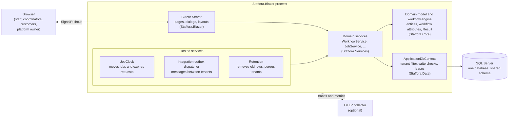

# Architecture

A short tour of how Staffora is put together, for a developer who reads the code for the first time. What the product does is in [PRODUCT.md](../PRODUCT.md). The rules every change follows are in [.github/copilot-instructions.md](../.github/copilot-instructions.md), and the reasons behind them are in the [ADRs](adr/).

## Containers and layers

Staffora is one ASP.NET Core process serving Blazor Server, over one SQL Server database with a shared schema. Tenants share every table and are kept apart by the data context.

- **Staffora.Core** holds the entities, the workflow engine (`Workflow/`), the declared lifecycles (`Workflow/WorkflowAttributes/`), the execution context and `Result`. It references EF Core and the ASP.NET Core Identity store types: `ApplicationUser` and `ApplicationRole` derive from Identity's classes, and contracts such as `IApplicationDbContextFactory` name EF Core types. It has no reference to the web layer.
- **Staffora.Data** holds `ApplicationDbContext`, its configurations, the single migration line and tenant isolation. Contexts come only from a singleton factory, one per unit of work.
- **Staffora.Services** holds the domain services, one folder per area. Every user-facing service operation checks the caller's permission and returns a `Result`. The exceptions are deliberate and listed with their reasons in `ServicePermissionScanTests`: reads of the caller's own data, platform-console operations gated by platform reach, and infrastructure services (session resolution, the workflow engine, the hosted services).
- **Staffora.Blazor** holds the pages, the shared components and the dialogs. Components call services and never touch a data context.
- **Hosted services** run inside the same process with no user circuit: the job clock, the outbox dispatcher and the retention pass. Each acts for one tenant at a time as that tenant's system account ([ADR 0041](adr/0041-a-request-expires-by-a-system-step.md), [ADR 0042](adr/0042-retention-and-the-tenant-purge.md)).

## A workflow step, end to end

Every entity with a lifecycle (a job, a slot, an assignment, an absence, a user, a tenant and so on) is changed only by a workflow step, and only in its dialog ([ADR 0001](adr/0001-workflow-engine-for-state-entities.md), [ADR 0009](adr/0009-state-entity-dialog-only-and-workflow-governed-attributes.md)). Here is what happens when a coordinator presses "Confirm" on a job:

1. **The dialog.** The job dialog was opened through one service call that returned a `DetachedEntityUpdater<Job>` ([ADR 0017](adr/0017-dialogs-load-through-one-service-call.md)). The user's edits live in that updater, and the footer buttons are the transitions the workflow offers from the job's current state, greyed with a reason when a condition blocks them.
2. **The service.** The button calls `JobService`, which checks the permission and hands the updater and the step's key to `WorkflowService.SaveAndTransitionAsync` ([ADR 0015](adr/0015-dialogs-save-through-a-detached-entity-updater.md)).
3. **Cheap refusals.** `WorkflowService` refuses at once when the step does not exist, does not leave the state the dialog was opened in, or is not the user's to take.
4. **One transaction.** It opens a context for the user's tenant and a transaction, takes the step's locks, loads the job with its workflow graph, applies the edits, and judges the step's conditions against the edited row. Edits to a field the current state locks are refused.
5. **The step.** It runs the leave actions of the old state, the transition, the enter actions of the new one and any cascade to child entities through their own workflows ([ADR 0016](adr/0016-deletion-cascades-through-child-workflows.md)). It writes a state history row, queues any message for a linked tenant in the integration outbox in the same transaction, and the data context stamps the audit columns and checks every write against the tenant.
6. **Commit, then the rest.** Only after the commit does the step's after-commit work run: notifications to the people involved ([ADR 0011](adr/0011-notifications-from-workflow-after-commit.md)) and the live refresh of open pages in the same tenant. The hosted outbox dispatcher delivers the queued messages to the linked tenant later, separately from the step.
7. **The answer.** The service returns a `Result`. The dialog shows the refusal's reasons, or reloads in the new state.

Steps the system takes (a job whose period has begun, a request whose answer time has passed) go through the same engine as the system account, with no circuit and no user.

## Tenant isolation, layer by layer

The tenant promise in [PRODUCT.md](../PRODUCT.md) is enforced in several places, so a mistake in one does not leak data ([ADR 0013](adr/0013-tenant-isolation-in-the-data-context.md)). This is an overview; the authoritative rules, exceptions and allow-lists are in [tenant-isolation.md](tenant-isolation.md).

1. **The session.** `UserSessionService` resolves the tenant, the user and any impersonation from the auth cookie once per circuit into `IRuntimeExecutionContext`. Nothing else reads claims, and nothing is kept in browser storage ([ADR 0014](adr/0014-session-on-the-auth-cookie-audited-impersonation.md)).
2. **The read filter.** Every tenant-owned entity implements `ITenantEntity` and gets a global query filter on `TenantId`. With no tenant, the filter returns no rows. A foreign id reads like a missing one.
3. **The write checks.** `SaveChanges` refuses a write without a tenant, an insert for another tenant, any change of `TenantId`, and an update or delete of a row the database holds for another tenant. `BulkUpdateGuard` brings `ExecuteUpdate` and `ExecuteDelete` under the same rule.
4. **Leases, not flags.** Leaving the tenant is an explicit, disposable lease with a reason, logged when it opens: a platform lease for the platform owner's console, a system lease for startup and hosted work. A write into another tenant on its behalf is stamped with that tenant's system account.
5. **Source scans.** `DataContextScanTests` reads the source and allows `IgnoreQueryFilters`, system contexts, leases and raw SQL only in listed files, and checks that every context is disposed. A model test checks that every entity with a `TenantId` has the filter.
6. **Tests against SQL Server.** The integration suite proves isolation on a real database: two tenants, every table swept, every refusal exercised (`Staffora.Test/Integration/Data/`).

Between tenants, the only link is a staffing company and the customer tenants it manages for its portal. After an order is sent, everything crosses as messages through the integration outbox, handled once and in order by the hosted dispatcher, acting as the receiving tenant ([ADR 0007](adr/0007-cross-tenant-ordering-customer-portal.md)).

## Key architecture decisions

| ADR | Decision |
|---|---|
| [0001](adr/0001-workflow-engine-for-state-entities.md), [0002](adr/0002-workflowservice-orchestration.md) | A declarative workflow engine, and one service that runs every step |
| [0005](adr/0005-code-style-and-english-ui.md) | Code style and English UI |
| [0007](adr/0007-cross-tenant-ordering-customer-portal.md) | Cross-tenant ordering through a customer portal and an outbox |
| [0008](adr/0008-users-become-resources-through-a-role.md) | Users become staff through a resource role |
| [0009](adr/0009-state-entity-dialog-only-and-workflow-governed-attributes.md) | State entities live only in their dialogs |
| [0012](adr/0012-platform-owner-and-tenant-onboarding.md) | The platform owner and tenant onboarding |
| [0013](adr/0013-tenant-isolation-in-the-data-context.md) | Tenant isolation in the data context |
| [0014](adr/0014-session-on-the-auth-cookie-audited-impersonation.md) | Session on the auth cookie, audited impersonation |
| [0018](adr/0018-test-strategy.md) | The test strategy |
| [0020](adr/0020-dates-and-times.md) | Dates and times |
| [0022](adr/0022-data-model-conventions.md) | Data model conventions |
| [0026](adr/0026-coordination-workspace-hour-timeline.md) | The coordination workspace and its hour timeline |
| [0027](adr/0027-generic-resource-staffing.md) | Jobs with slots staff any service business |
| [0039](adr/0039-opentelemetry-is-the-telemetry-standard.md) | OpenTelemetry for telemetry |
| [0042](adr/0042-retention-and-the-tenant-purge.md) | Retention and the tenant purge |

## Running more than one instance

The app runs as a single instance. The notification bell and the live refresh of open pages use in-process buses, and the hosted services run in the process. A second instance needs a backplane behind those buses, a shared Data Protection key store (`DataProtection:KeysPath` on shared storage, or another store), and the hosted services confined to one instance or proven safe on several. [known-issues.md](known-issues.md) tracks it as KI-69.

## Further reading

- [Tenant isolation](tenant-isolation.md), [Database model](database.md), [Authorization and roles](authorization.md), [Authentication and sessions](authentication.md)
- [Features](features.md): the index of the feature documents, among them [Lists, URL state and dialogs](features/lists-and-dialogs.md), [Operations](features/operations.md) (integration outbox, error log, retention, telemetry) and [Coordination workspace](features/coordination-and-homes.md#coordination-workspace)
- [Known issues](known-issues.md) and [Roadmap](roadmap.md)
